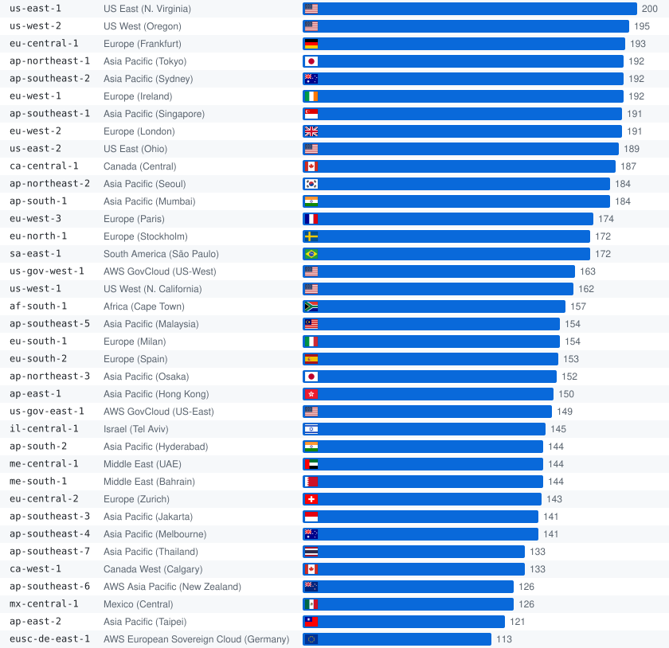

# aws-region-table-parser

Which AWS services are available in which AWS region, as JSON and as tables below.
Updated daily from the data behind AWS's [services by region](https://aws.amazon.com/about-aws/global-infrastructure/regional-product-services/) page.

Includes AWS GovCloud (US), the AWS European Sovereign Cloud and [AWS China](#aws-china) (Beijing and Ningxia, from amazonaws.cn with its own service names).

## Get the data

| Data | JSON |
| --- | --- |
| Every service and the regions it's in | [service_info.json](https://raw.githubusercontent.com/burib/aws-region-table-parser/master/data/service_info.json) |
| Every region and the services it offers | [region_info.json](https://raw.githubusercontent.com/burib/aws-region-table-parser/master/data/region_info.json) |
| One region | [region_info/&lt;region&gt;.json](./data/region_info) |
| AWS China services (Beijing, Ningxia) | [china.json](https://raw.githubusercontent.com/burib/aws-region-table-parser/master/data/china.json) |
| Region code to name | [region_code_to_name_map.json](https://raw.githubusercontent.com/burib/aws-region-table-parser/master/region_code_to_name_map.json) |

Or from Node.js, with no dependencies:

```sh
npm i aws-region-table-parser
```

```js
const regions = require('aws-region-table-parser');

await regions.isServiceAvailable('AWS Lambda', 'eu-central-2'); // true
await regions.getRegionsForService('Lambda');       // ['af-south-1', 'ap-east-1', ...]
await regions.getServicesInRegion('eu-central-2');  // ['AD Connector', ...]
await regions.getServiceNames();                    // every service name
await regions.getRegionCodeToNameMap();             // { 'us-east-1': 'US East (N. Virginia)', ... }
await regions.get();                                // everything, as in service_info.json
```

Service names ignore case, and you can leave out "AWS" or "Amazon" when the name is still unique.
An unknown service name throws an error that tells you which names exist.

## Stay up to date

Every change in AWS's data gets a [release](https://github.com/burib/aws-region-table-parser/releases) that lists what changed: new regions, new services, and services that reached more regions.

- **GitHub:** at the top of this page, click **Watch** → **Custom** → **Releases** → **Apply**.
- **RSS:** add `https://github.com/burib/aws-region-table-parser/releases.atom` to your feed reader.
- **npm:** every release is also a new version of [`aws-region-table-parser`](https://www.npmjs.com/package/aws-region-table-parser).

<!--START_SECTION:region_summary-->
**200 services** in **37 regions**, plus [AWS China](#aws-china) with 121 services in 2 regions · data as of 2026-11-26

## Services per region

<p>
<picture>
  <source media="(prefers-color-scheme: dark)" srcset="./assets/services-per-region-dark.svg">
  
</picture>
</p>

| Region | Name | Services |
| --- | --- | ---: |
| [us-east-1](./data/region_info/us-east-1.json) | US East (N. Virginia) | 200 |
| [us-west-2](./data/region_info/us-west-2.json) | US West (Oregon) | 195 |
| [eu-central-1](./data/region_info/eu-central-1.json) | Europe (Frankfurt) | 193 |
| [ap-northeast-1](./data/region_info/ap-northeast-1.json) | Asia Pacific (Tokyo) | 192 |
| [ap-southeast-2](./data/region_info/ap-southeast-2.json) | Asia Pacific (Sydney) | 192 |
| [eu-west-1](./data/region_info/eu-west-1.json) | Europe (Ireland) | 192 |
| [ap-southeast-1](./data/region_info/ap-southeast-1.json) | Asia Pacific (Singapore) | 191 |
| [eu-west-2](./data/region_info/eu-west-2.json) | Europe (London) | 191 |
| [us-east-2](./data/region_info/us-east-2.json) | US East (Ohio) | 189 |
| [ca-central-1](./data/region_info/ca-central-1.json) | Canada (Central) | 187 |
| [ap-northeast-2](./data/region_info/ap-northeast-2.json) | Asia Pacific (Seoul) | 184 |
| [ap-south-1](./data/region_info/ap-south-1.json) | Asia Pacific (Mumbai) | 184 |
| [eu-west-3](./data/region_info/eu-west-3.json) | Europe (Paris) | 174 |
| [eu-north-1](./data/region_info/eu-north-1.json) | Europe (Stockholm) | 172 |
| [sa-east-1](./data/region_info/sa-east-1.json) | South America (São Paulo) | 172 |
| [us-gov-west-1](./data/region_info/us-gov-west-1.json) | AWS GovCloud (US-West) | 163 |
| [us-west-1](./data/region_info/us-west-1.json) | US West (N. California) | 162 |
| [af-south-1](./data/region_info/af-south-1.json) | Africa (Cape Town) | 157 |
| [ap-southeast-5](./data/region_info/ap-southeast-5.json) | Asia Pacific (Malaysia) | 154 |
| [eu-south-1](./data/region_info/eu-south-1.json) | Europe (Milan) | 154 |
| [eu-south-2](./data/region_info/eu-south-2.json) | Europe (Spain) | 153 |
| [ap-northeast-3](./data/region_info/ap-northeast-3.json) | Asia Pacific (Osaka) | 152 |
| [ap-east-1](./data/region_info/ap-east-1.json) | Asia Pacific (Hong Kong) | 150 |
| [us-gov-east-1](./data/region_info/us-gov-east-1.json) | AWS GovCloud (US-East) | 149 |
| [il-central-1](./data/region_info/il-central-1.json) | Israel (Tel Aviv) | 145 |
| [ap-south-2](./data/region_info/ap-south-2.json) | Asia Pacific (Hyderabad) | 144 |
| [me-central-1](./data/region_info/me-central-1.json) | Middle East (UAE) | 144 |
| [me-south-1](./data/region_info/me-south-1.json) | Middle East (Bahrain) | 144 |
| [eu-central-2](./data/region_info/eu-central-2.json) | Europe (Zurich) | 143 |
| [ap-southeast-3](./data/region_info/ap-southeast-3.json) | Asia Pacific (Jakarta) | 141 |
| [ap-southeast-4](./data/region_info/ap-southeast-4.json) | Asia Pacific (Melbourne) | 141 |
| [ap-southeast-7](./data/region_info/ap-southeast-7.json) | Asia Pacific (Thailand) | 133 |
| [ca-west-1](./data/region_info/ca-west-1.json) | Canada West (Calgary) | 133 |
| [ap-southeast-6](./data/region_info/ap-southeast-6.json) | AWS Asia Pacific (New Zealand) | 126 |
| [mx-central-1](./data/region_info/mx-central-1.json) | Mexico (Central) | 126 |
| [ap-east-2](./data/region_info/ap-east-2.json) | Asia Pacific (Taipei) | 121 |
| [eusc-de-east-1](./data/region_info/eusc-de-east-1.json) | AWS European Sovereign Cloud (Germany) | 113 |
| [cn-north-1](./data/region_info/cn-north-1.json) | China (Beijing) | 112 |
| [cn-northwest-1](./data/region_info/cn-northwest-1.json) | China (Ningxia) | 112 |

## Where each service is available

| Service | Regions | Where |
| --- | ---: | --- |
| [AD Connector](https://docs.aws.amazon.com/directoryservice/latest/admin-guide/directory_ad_connector.html) | 37 | all |
| [Amazon API Gateway](https://aws.amazon.com/api-gateway/) | 37 | all |
| [Amazon AppFlow](https://aws.amazon.com/appflow/) | 16 | af-south-1, ap-northeast-1, ap-northeast-2, ap-south-1, ap-southeast-1, ap-southeast-2, ca-central-1, eu-central-1, eu-west-1, eu-west-2, eu-west-3, sa-east-1, us-east-1, us-east-2, us-west-1, us-west-2 |
| [Amazon Application Recovery Controller](https://aws.amazon.com/application-recovery-controller/) | 37 | all |
| [Amazon Athena](https://aws.amazon.com/athena/) | 37 | all |
| [Amazon Aurora](https://aws.amazon.com/rds/aurora/) | 37 | all |
| [Amazon Aurora DSQL](https://aws.amazon.com/rds/aurora/dsql/) | 20 | all except af-south-1, ap-east-2, ap-south-2, ap-southeast-3, ap-southeast-5, ap-southeast-6, ap-southeast-7, eu-central-2, eu-south-1, eusc-de-east-1, il-central-1, me-central-1, me-south-1, mx-central-1, us-gov-east-1, us-gov-west-1, us-west-1 |
| [Amazon Aurora MySQL](https://aws.amazon.com/rds/aurora/) | 37 | all |
| [Amazon Aurora PostgreSQL](https://aws.amazon.com/rds/aurora/) | 37 | all |
| [Amazon Bedrock](https://aws.amazon.com/bedrock/) | 36 | all except ap-east-1 |
| [Amazon Bedrock AgentCore](https://aws.amazon.com/bedrock/agentcore/) | 22 | all except af-south-1, ap-east-1, ap-east-2, ap-northeast-3, ap-southeast-3, ap-southeast-4, ap-southeast-6, ca-west-1, eu-central-2, eusc-de-east-1, il-central-1, me-central-1, me-south-1, mx-central-1, us-gov-east-1 |
| [Amazon Bedrock AgentCore Registry](https://docs.aws.amazon.com/agent-registry/) | 10 | ap-northeast-1, ap-southeast-2, ca-central-1, eu-central-1, eu-west-1, eu-west-2, us-east-1, us-east-2, us-gov-west-1, us-west-2 |
| [Amazon Braket](https://aws.amazon.com/braket/) | 5 | eu-north-1, eu-west-2, us-east-1, us-west-1, us-west-2 |
| [Amazon Chime SDK](https://aws.amazon.com/chime/chime-sdk/) | 21 | all except ap-east-1, ap-east-2, ap-northeast-3, ap-south-2, ap-southeast-3, ap-southeast-4, ap-southeast-5, ap-southeast-6, ap-southeast-7, ca-west-1, eu-central-2, eu-south-2, eusc-de-east-1, me-central-1, me-south-1, mx-central-1 |
| [Amazon CloudFront](https://aws.amazon.com/cloudfront/) | 35 | all except us-gov-east-1, us-gov-west-1 |
| [Amazon CloudWatch](https://aws.amazon.com/cloudwatch/) | 37 | all |
| [Amazon CloudWatch Logs](https://aws.amazon.com/cloudwatch/) | 37 | all |
| [Amazon Cognito](https://aws.amazon.com/cognito/) | 37 | all |
| [Amazon Comprehend](https://aws.amazon.com/comprehend/) | 13 | ap-northeast-1, ap-northeast-2, ap-south-1, ap-southeast-1, ap-southeast-2, ca-central-1, eu-central-1, eu-west-1, eu-west-2, us-east-1, us-east-2, us-gov-west-1, us-west-2 |
| [Amazon Connect](https://aws.amazon.com/connect/) | 11 | af-south-1, ap-northeast-1, ap-northeast-2, ap-southeast-1, ap-southeast-2, ca-central-1, eu-central-1, eu-west-2, us-east-1, us-gov-west-1, us-west-2 |
| [Amazon Connect Health](https://aws.amazon.com/products/connect/health/) | 3 | eu-west-2, us-east-1, us-west-2 |
| [Amazon Data Firehose](https://aws.amazon.com/firehose/) | 37 | all |
| [Amazon DataZone](https://aws.amazon.com/datazone/) | 21 | all except ap-east-2, ap-northeast-3, ap-south-2, ap-southeast-3, ap-southeast-4, ap-southeast-6, ca-west-1, eu-south-1, eusc-de-east-1, il-central-1, me-central-1, me-south-1, mx-central-1, us-gov-east-1, us-gov-west-1, us-west-1 |
| [Amazon Detective](https://aws.amazon.com/detective/) | 23 | all except ap-east-2, ap-northeast-3, ap-south-2, ap-southeast-3, ap-southeast-4, ap-southeast-5, ap-southeast-6, ap-southeast-7, ca-west-1, eu-central-2, eu-south-2, eusc-de-east-1, me-central-1, mx-central-1 |
| [Amazon DocumentDB (with MongoDB compatibility)](https://aws.amazon.com/documentdb/) | 35 | all except me-south-1, us-west-1 |
| [Amazon DynamoDB](https://aws.amazon.com/dynamodb/) | 37 | all |
| [Amazon DynamoDB Accelerator](https://aws.amazon.com/dynamodb/dax/) | 34 | all except eusc-de-east-1, me-central-1, me-south-1 |
| [Amazon EC2 Auto Scaling](https://aws.amazon.com/ec2/autoscaling/) | 37 | all |
| [Amazon EC2 Image Builder](https://aws.amazon.com/image-builder/) | 37 | all |
| [Amazon Elastic Block Store (EBS)](https://aws.amazon.com/ebs/) | 37 | all |
| [Amazon Elastic Compute Cloud (EC2)](https://aws.amazon.com/ec2/) | 37 | all |
| [Amazon Elastic Container Registry (ECR)](https://aws.amazon.com/ecr/) | 37 | all |
| [Amazon Elastic Container Service (ECS)](https://aws.amazon.com/ecs/) | 37 | all |
| [Amazon Elastic File System (EFS)](https://aws.amazon.com/efs/) | 37 | all |
| [Amazon Elastic Kubernetes Service (EKS)](https://aws.amazon.com/eks) | 37 | all |
| [Amazon Elastic MapReduce (EMR)](https://aws.amazon.com/emr/) | 37 | all |
| [Amazon Elastic VMware Service (EVS)](https://aws.amazon.com/evs/) | 26 | all except af-south-1, ap-east-1, ap-southeast-3, ap-southeast-4, ap-southeast-6, ap-southeast-7, eusc-de-east-1, me-central-1, me-south-1, us-gov-east-1, us-gov-west-1 |
| [Amazon ElastiCache](https://aws.amazon.com/elasticache/) | 37 | all |
| [Amazon EventBridge](https://aws.amazon.com/eventbridge/) | 37 | all |
| [Amazon FSx](https://aws.amazon.com/fsx/) | 37 | all |
| [Amazon FSx for Lustre](https://aws.amazon.com/fsx/lustre/) | 37 | all |
| [Amazon FSx for NetApp ONTAP](https://aws.amazon.com/fsx/netapp-ontap) | 37 | all |
| [Amazon FSx for OpenZFS](https://aws.amazon.com/fsx/openzfs) | 37 | all |
| [Amazon FSx for Windows File Server](https://aws.amazon.com/fsx/windows/) | 37 | all |
| [Amazon GameLift Servers](https://aws.amazon.com/gamelift/servers/) | 29 | all except ap-east-2, ap-southeast-4, ap-southeast-6, ca-west-1, eu-central-2, eusc-de-east-1, us-gov-east-1, us-gov-west-1 |
| [Amazon GuardDuty](https://aws.amazon.com/guardduty/) | 37 | all |
| [Amazon Inspector](https://aws.amazon.com/inspector/) | 35 | all except ap-southeast-6, eusc-de-east-1 |
| [Amazon Interactive Video Service (IVS)](https://aws.amazon.com/ivs/) | 7 | ap-northeast-1, ap-northeast-2, ap-south-1, eu-central-1, eu-west-1, us-east-1, us-west-2 |
| [Amazon Kendra](https://aws.amazon.com/kendra/) | 11 | ap-northeast-1, ap-south-1, ap-southeast-1, ap-southeast-2, ca-central-1, eu-west-1, eu-west-2, us-east-1, us-east-2, us-gov-west-1, us-west-2 |
| [Amazon Keyspaces (for Apache Cassandra)](https://aws.amazon.com/keyspaces/) | 36 | all except eusc-de-east-1 |
| [Amazon Kinesis Data Streams](https://aws.amazon.com/kinesis/streams/) | 37 | all |
| [Amazon Kinesis Video Streams](https://aws.amazon.com/kinesis/video-streams/) | 22 | all except ap-east-2, ap-northeast-3, ap-south-2, ap-southeast-3, ap-southeast-4, ap-southeast-6, ap-southeast-7, ca-west-1, eu-central-2, eu-north-1, eu-south-1, eusc-de-east-1, me-central-1, mx-central-1, us-west-1 |
| [Amazon Lex](https://aws.amazon.com/lex/) | 11 | af-south-1, ap-northeast-1, ap-northeast-2, ap-southeast-1, ap-southeast-2, ca-central-1, eu-central-1, eu-west-2, us-east-1, us-gov-west-1, us-west-2 |
| [Amazon Lightsail](https://amazonlightsail.com/) | 19 | all except af-south-1, ap-east-2, ap-northeast-3, ap-south-2, ap-southeast-4, ap-southeast-6, ap-southeast-7, ca-west-1, eu-central-2, eu-south-1, eusc-de-east-1, il-central-1, me-central-1, me-south-1, mx-central-1, us-gov-east-1, us-gov-west-1, us-west-1 |
| [Amazon Location Service](https://aws.amazon.com/location) | 16 | ap-northeast-1, ap-south-1, ap-southeast-1, ap-southeast-2, ap-southeast-5, ca-central-1, eu-central-1, eu-north-1, eu-south-2, eu-west-1, eu-west-2, sa-east-1, us-east-1, us-east-2, us-gov-west-1, us-west-2 |
| [Amazon Managed Blockchain (AMB)](https://aws.amazon.com/managed-blockchain/) | 7 | ap-northeast-1, ap-northeast-2, ap-southeast-1, eu-west-1, eu-west-2, us-east-1, us-gov-west-1 |
| [Amazon Managed Grafana](https://aws.amazon.com/grafana/) | 12 | ap-northeast-1, ap-northeast-2, ap-southeast-1, ap-southeast-2, eu-central-1, eu-west-1, eu-west-2, us-east-1, us-east-2, us-gov-east-1, us-gov-west-1, us-west-2 |
| [Amazon Managed Service for Apache Flink](https://aws.amazon.com/managed-service-apache-flink/) | 37 | all |
| [Amazon Managed Service for Prometheus](https://aws.amazon.com/prometheus/) | 37 | all |
| [Amazon Managed Streaming for Apache Kafka (MSK)](https://aws.amazon.com/msk/) | 37 | all |
| [Amazon Managed Workflows for Apache Airflow (MWAA)](https://aws.amazon.com/managed-workflows-for-apache-airflow/) | 32 | all except ap-east-2, ap-southeast-6, eusc-de-east-1, us-gov-east-1, us-gov-west-1 |
| [Amazon MemoryDB](https://aws.amazon.com/memorydb) | 21 | all except af-south-1, ap-east-2, ap-northeast-3, ap-south-2, ap-southeast-3, ap-southeast-4, ap-southeast-5, ap-southeast-6, ap-southeast-7, ca-west-1, eu-central-2, eusc-de-east-1, il-central-1, me-central-1, me-south-1, mx-central-1 |
| [Amazon MQ](https://aws.amazon.com/amazon-mq/) | 37 | all |
| [Amazon Neptune](https://aws.amazon.com/neptune/) | 33 | all except ap-east-2, ap-southeast-6, eu-south-1, mx-central-1 |
| [Amazon OpenSearch Service](https://aws.amazon.com/opensearch-service/) | 37 | all |
| [Amazon Personalize](https://aws.amazon.com/personalize/) | 11 | ap-northeast-1, ap-northeast-2, ap-south-1, ap-southeast-1, ap-southeast-2, ca-central-1, eu-central-1, eu-west-1, us-east-1, us-east-2, us-west-2 |
| [Amazon Q Business](https://aws.amazon.com/q/business/) | 4 | ap-southeast-2, eu-west-1, us-east-1, us-west-2 |
| [Amazon Q Developer](https://aws.amazon.com/q/developer/) | 4 | eu-central-1, us-east-1, us-gov-east-1, us-gov-west-1 |
| [Amazon RDS Custom for Oracle](https://aws.amazon.com/rds/custom/) | 21 | all except af-south-1, ap-east-1, ap-east-2, ap-south-2, ap-southeast-4, ap-southeast-5, ap-southeast-6, ap-southeast-7, ca-west-1, eu-central-2, eu-south-2, eusc-de-east-1, il-central-1, me-south-1, mx-central-1, us-west-1 |
| [Amazon RDS Custom for SQL Server](https://aws.amazon.com/rds/custom/) | 18 | af-south-1, ap-northeast-1, ap-northeast-2, ap-northeast-3, ap-south-1, ap-southeast-1, ap-southeast-2, ca-central-1, eu-central-1, eu-north-1, eu-west-1, eu-west-2, eu-west-3, sa-east-1, us-east-1, us-east-2, us-west-1, us-west-2 |
| [Amazon RDS for Db2](https://aws.amazon.com/rds/db2/) | 36 | all except eusc-de-east-1 |
| [Amazon RDS for MariaDB](https://aws.amazon.com/rds/mariadb/) | 37 | all |
| [Amazon RDS for MySQL](https://aws.amazon.com/rds/mysql/) | 37 | all |
| [Amazon RDS for Oracle](https://aws.amazon.com/rds/oracle/) | 37 | all |
| [Amazon RDS for PostgreSQL](https://aws.amazon.com/rds/postgresql/) | 37 | all |
| [Amazon RDS for SQL Server](https://aws.amazon.com/rds/sqlserver/) | 37 | all |
| [Amazon Redshift](https://aws.amazon.com/redshift/) | 37 | all |
| [Amazon Rekognition](https://aws.amazon.com/rekognition/) | 19 | all except af-south-1, ap-east-1, ap-east-2, ap-northeast-3, ap-south-2, ap-southeast-3, ap-southeast-4, ap-southeast-6, ca-west-1, eu-central-2, eu-north-1, eu-south-1, eu-west-3, eusc-de-east-1, me-central-1, me-south-1, mx-central-1, us-gov-east-1 |
| [Amazon Relational Database Service (RDS)](https://aws.amazon.com/rds/) | 37 | all |
| [Amazon Route 53](https://aws.amazon.com/route53/) | 37 | all |
| [Amazon Route 53 Private DNS](http://aws.amazon.com/route53/) | 37 | all |
| [Amazon Route 53 Public DNS](https://aws.amazon.com/route53/) | 37 | all |
| [Amazon S3 on Outposts](https://aws.amazon.com/s3/outposts/) | 25 | all except ap-east-2, ap-south-2, ap-southeast-4, ap-southeast-5, ap-southeast-6, ap-southeast-7, ca-west-1, eu-central-2, eu-south-2, eusc-de-east-1, me-central-1, mx-central-1 |
| [Amazon SageMaker AI](https://aws.amazon.com/sagemaker-ai/) | 37 | all |
| [Amazon SageMaker Ground Truth](https://aws.amazon.com/sagemaker/ai/groundtruth/) | 12 | ap-northeast-1, ap-northeast-2, ap-south-1, ap-southeast-1, ap-southeast-2, ca-central-1, eu-central-1, eu-west-1, eu-west-2, us-east-1, us-east-2, us-west-2 |
| [Amazon Security Lake](https://aws.amazon.com/security-lake/) | 19 | all except af-south-1, ap-east-1, ap-east-2, ap-south-2, ap-southeast-3, ap-southeast-4, ap-southeast-5, ap-southeast-6, ap-southeast-7, ca-west-1, eu-central-2, eu-south-1, eu-south-2, eusc-de-east-1, il-central-1, me-central-1, me-south-1, mx-central-1 |
| [Amazon Simple Email Service (SES)](https://aws.amazon.com/ses/) | 37 | all |
| [Amazon Simple Notification Service (SNS)](https://aws.amazon.com/sns/) | 37 | all |
| [Amazon Simple Queue Service (SQS)](https://aws.amazon.com/sqs/) | 37 | all |
| [Amazon Simple Storage Service (S3)](https://aws.amazon.com/s3/) | 37 | all |
| [Amazon Simple Workflow Service (SWF)](https://aws.amazon.com/swf/) | 37 | all |
| [Amazon Textract](https://aws.amazon.com/textract) | 18 | ap-northeast-1, ap-northeast-2, ap-south-1, ap-southeast-1, ap-southeast-2, ca-central-1, eu-central-1, eu-central-2, eu-south-2, eu-west-1, eu-west-2, eu-west-3, us-east-1, us-east-2, us-gov-east-1, us-gov-west-1, us-west-1, us-west-2 |
| [Amazon Transcribe](https://aws.amazon.com/transcribe/) | 26 | all except ap-east-2, ap-northeast-3, ap-south-2, ap-southeast-3, ap-southeast-4, ap-southeast-6, ca-west-1, eu-south-1, eu-south-2, il-central-1, me-central-1 |
| [Amazon Translate](https://aws.amazon.com/translate/) | 17 | ap-east-1, ap-northeast-1, ap-northeast-2, ap-south-1, ap-southeast-1, ap-southeast-2, ca-central-1, eu-central-1, eu-north-1, eu-west-1, eu-west-2, eu-west-3, us-east-1, us-east-2, us-gov-west-1, us-west-1, us-west-2 |
| [Amazon Verified Permissions](https://aws.amazon.com/verified-permissions/) | 37 | all |
| [Amazon Virtual Private Cloud (VPC)](https://aws.amazon.com/vpc/) | 37 | all |
| [Amazon VPC Lattice](https://aws.amazon.com/vpc/lattice/) | 30 | all except ap-east-2, ap-southeast-6, ap-southeast-7, eusc-de-east-1, il-central-1, us-gov-east-1, us-gov-west-1 |
| [Amazon WorkSpaces](https://aws.amazon.com/workspaces/) | 19 | all except ap-east-1, ap-east-2, ap-northeast-3, ap-south-2, ap-southeast-3, ap-southeast-4, ap-southeast-6, ap-southeast-7, ca-west-1, eu-central-2, eu-north-1, eu-south-1, eu-south-2, eusc-de-east-1, me-central-1, me-south-1, mx-central-1, us-west-1 |
| [Amazon WorkSpaces Applications](https://aws.amazon.com/workspaces/applications/) | 23 | all except af-south-1, ap-east-1, ap-east-2, ap-south-2, ap-southeast-3, ap-southeast-4, ap-southeast-6, ap-southeast-7, eu-north-1, eusc-de-east-1, me-central-1, me-south-1, mx-central-1, us-west-1 |
| [AWS Amplify](https://aws.amazon.com/amplify/) | 20 | all except af-south-1, ap-east-2, ap-south-2, ap-southeast-3, ap-southeast-4, ap-southeast-5, ap-southeast-6, ap-southeast-7, ca-west-1, eu-central-2, eu-south-2, eusc-de-east-1, il-central-1, me-central-1, mx-central-1, us-gov-east-1, us-gov-west-1 |
| [AWS App Runner](https://aws.amazon.com/apprunner/) | 11 | ap-northeast-1, ap-south-1, ap-southeast-1, ap-southeast-2, eu-central-1, eu-west-1, eu-west-2, eu-west-3, us-east-1, us-east-2, us-west-2 |
| [AWS AppConfig](https://aws.amazon.com/systems-manager/features/appconfig/) | 37 | all |
| [AWS Application Auto Scaling](https://aws.amazon.com/autoscaling/) | 37 | all |
| [AWS Application Migration Service (MGN)](https://aws.amazon.com/application-migration-service/) | 36 | all except eusc-de-east-1 |
| [AWS AppSync](https://aws.amazon.com/appsync/) | 31 | all except ap-east-2, ap-southeast-6, eusc-de-east-1, mx-central-1, us-gov-east-1, us-gov-west-1 |
| [AWS Audit Manager](https://aws.amazon.com/audit-manager/) | 12 | ap-northeast-1, ap-south-1, ap-southeast-1, ap-southeast-2, ca-central-1, eu-central-1, eu-west-1, eu-west-2, us-east-1, us-east-2, us-west-1, us-west-2 |
| [AWS B2B Data Interchange](https://aws.amazon.com/b2b-data-interchange/) | 5 | ca-central-1, eu-west-1, us-east-1, us-east-2, us-west-2 |
| [AWS Backup](https://aws.amazon.com/backup/) | 37 | all |
| [AWS Batch](https://aws.amazon.com/batch/) | 37 | all |
| [AWS Certificate Manager (ACM)](https://aws.amazon.com/certificate-manager/) | 37 | all |
| [AWS Client VPN](https://aws.amazon.com/vpn/client-vpn/) | 36 | all except eusc-de-east-1 |
| [AWS Cloud Map](https://aws.amazon.com/cloud-map/) | 37 | all |
| [AWS Cloud WAN](https://aws.amazon.com/cloud-wan/) | 33 | all except ap-east-1, eusc-de-east-1, mx-central-1, sa-east-1 |
| [AWS CloudFormation](https://aws.amazon.com/cloudformation/) | 37 | all |
| [AWS CloudHSM](https://aws.amazon.com/cloudhsm/) | 34 | all except ap-east-2, ap-southeast-4, eusc-de-east-1 |
| [AWS CloudShell](https://aws.amazon.com/cloudshell/) | 33 | all except ap-east-2, ap-southeast-6, eusc-de-east-1, mx-central-1 |
| [AWS CloudTrail](https://aws.amazon.com/cloudtrail/) | 37 | all |
| [AWS CodeArtifact](https://aws.amazon.com/codeartifact) | 13 | ap-northeast-1, ap-south-1, ap-southeast-1, ap-southeast-2, eu-central-1, eu-north-1, eu-south-1, eu-west-1, eu-west-2, eu-west-3, us-east-1, us-east-2, us-west-2 |
| [AWS CodeBuild](https://aws.amazon.com/codebuild/) | 34 | all except ap-east-2, ca-west-1, mx-central-1 |
| [AWS CodeCommit](https://aws.amazon.com/codecommit/) | 27 | all except ap-east-2, ap-southeast-4, ap-southeast-5, ap-southeast-6, ap-southeast-7, ca-west-1, eu-central-2, eu-south-2, eusc-de-east-1, mx-central-1 |
| [AWS CodeDeploy](https://aws.amazon.com/codedeploy/) | 37 | all |
| [AWS CodePipeline](https://aws.amazon.com/codepipeline/) | 33 | all except ap-east-2, ap-southeast-7, ca-west-1, mx-central-1 |
| [AWS Config](https://aws.amazon.com/config/) | 37 | all |
| [AWS Control Tower](https://aws.amazon.com/controltower) | 37 | all |
| [AWS Database Migration Service (AWS DMS)](https://aws.amazon.com/dms/) | 37 | all |
| [AWS DataSync](https://aws.amazon.com/datasync) | 37 | all |
| [AWS Deadline Cloud](https://aws.amazon.com/deadline-cloud/) | 10 | ap-northeast-1, ap-northeast-2, ap-southeast-1, ap-southeast-2, eu-central-1, eu-west-1, eu-west-2, us-east-1, us-east-2, us-west-2 |
| [AWS DevOps Agent](https://aws.amazon.com/devops-agent/) | 16 | ap-northeast-1, ap-northeast-2, ap-south-1, ap-southeast-1, ap-southeast-2, ca-central-1, eu-central-1, eu-north-1, eu-west-1, eu-west-2, eu-west-3, sa-east-1, us-east-1, us-east-2, us-gov-west-1, us-west-2 |
| [AWS Direct Connect](https://aws.amazon.com/directconnect/) | 37 | all |
| [AWS Directory Service](https://aws.amazon.com/directoryservice/) | 37 | all |
| [AWS Directory Service for Microsoft Active Directory](https://docs.aws.amazon.com/directoryservice/latest/admin-guide/directory_microsoft_ad.html) | 37 | all |
| [AWS Elastic Beanstalk](https://aws.amazon.com/elasticbeanstalk/) | 34 | all except ap-east-2, eusc-de-east-1, mx-central-1 |
| [AWS Elastic Disaster Recovery (DRS)](https://aws.amazon.com/disaster-recovery/) | 37 | all |
| [AWS Elemental MediaConnect](https://aws.amazon.com/mediaconnect) | 23 | all except ap-east-2, ap-southeast-3, ap-southeast-6, ap-southeast-7, ca-west-1, eu-central-2, eu-south-1, eu-south-2, eusc-de-east-1, il-central-1, me-south-1, mx-central-1, us-gov-east-1, us-gov-west-1 |
| [AWS Elemental MediaConvert](https://aws.amazon.com/mediaconvert/) | 22 | all except ap-east-1, ap-east-2, ap-south-2, ap-southeast-3, ap-southeast-6, ap-southeast-7, ca-west-1, eu-central-2, eu-south-1, eu-south-2, eusc-de-east-1, il-central-1, me-south-1, mx-central-1, us-gov-east-1 |
| [AWS Elemental MediaLive](https://aws.amazon.com/medialive/) | 20 | all except af-south-1, ap-east-1, ap-east-2, ap-southeast-3, ap-southeast-6, ap-southeast-7, ca-west-1, eu-central-2, eu-south-1, eu-south-2, eusc-de-east-1, il-central-1, me-south-1, mx-central-1, us-gov-east-1, us-gov-west-1, us-west-1 |
| [AWS Elemental MediaPackage](https://aws.amazon.com/mediapackage/) | 21 | all except af-south-1, ap-east-1, ap-east-2, ap-southeast-3, ap-southeast-6, ap-southeast-7, ca-west-1, eu-central-2, eu-south-1, eu-south-2, eusc-de-east-1, il-central-1, me-south-1, mx-central-1, us-gov-east-1, us-gov-west-1 |
| [AWS Elemental MediaTailor](https://aws.amazon.com/mediatailor/) | 21 | all except ap-east-1, ap-east-2, ap-southeast-3, ap-southeast-6, ap-southeast-7, ca-west-1, eu-central-2, eu-south-1, eu-south-2, eusc-de-east-1, il-central-1, me-south-1, mx-central-1, us-gov-east-1, us-gov-west-1, us-west-1 |
| [AWS Emulator](https://aws.amazon.com/products/developer-tools/emulator/) | 1 | us-east-1 |
| [AWS End User Messaging](https://aws.amazon.com/end-user-messaging/amazon-pinpoint-aws-end-user-messaging-landing-page/) | 37 | all |
| [AWS Fault Injection Service](https://aws.amazon.com/fis/) | 26 | all except ap-east-2, ap-south-2, ap-southeast-3, ap-southeast-4, ap-southeast-5, ap-southeast-6, ap-southeast-7, ca-west-1, eusc-de-east-1, il-central-1, mx-central-1 |
| [AWS Firewall Manager](https://aws.amazon.com/firewall-manager/) | 36 | all except eusc-de-east-1 |
| [AWS Global Accelerator](https://aws.amazon.com/global-accelerator) | 34 | all except eusc-de-east-1, us-gov-east-1, us-gov-west-1 |
| [AWS Glue](https://aws.amazon.com/glue/) | 37 | all |
| [AWS Ground Station](https://aws.amazon.com/ground-station/) | 12 | af-south-1, ap-northeast-2, ap-southeast-1, ap-southeast-2, eu-central-1, eu-north-1, eu-west-1, me-south-1, sa-east-1, us-east-1, us-east-2, us-west-2 |
| [AWS IAM Identity Center](https://aws.amazon.com/iam/identity-center/) | 37 | all |
| [AWS Identity and Access Management (IAM)](https://aws.amazon.com/iam) | 37 | all |
| [AWS Identity and Access Management (IAM) Access Analyzer](https://aws.amazon.com/iam/access-analyzer/) | 37 | all |
| [AWS Interconnect](https://aws.amazon.com/interconnect/) | 21 | all except ap-east-1, ap-northeast-2, ap-south-1, ap-south-2, ap-southeast-3, ap-southeast-5, ap-southeast-7, ca-west-1, eu-south-2, eusc-de-east-1, il-central-1, me-central-1, me-south-1, mx-central-1, us-gov-east-1, us-gov-west-1 |
| [AWS IoT Core](https://aws.amazon.com/iot/) | 25 | all except af-south-1, ap-east-2, ap-northeast-3, ap-south-2, ap-southeast-3, ap-southeast-4, ap-southeast-6, ap-southeast-7, ca-west-1, eu-central-2, eusc-de-east-1, mx-central-1 |
| [AWS IoT Device Defender](https://aws.amazon.com/iot-device-defender/) | 22 | all except af-south-1, ap-east-2, ap-northeast-3, ap-south-2, ap-southeast-3, ap-southeast-4, ap-southeast-6, ap-southeast-7, ca-west-1, eu-central-2, eu-south-1, eusc-de-east-1, il-central-1, mx-central-1, sa-east-1 |
| [AWS IoT Device Management](https://aws.amazon.com/iot-device-management/) | 25 | all except af-south-1, ap-east-2, ap-northeast-3, ap-south-2, ap-southeast-3, ap-southeast-4, ap-southeast-6, ap-southeast-7, ca-west-1, eu-central-2, eusc-de-east-1, mx-central-1 |
| [AWS IoT Greengrass](https://aws.amazon.com/greengrass/) | 16 | ap-northeast-1, ap-northeast-2, ap-south-1, ap-southeast-1, ap-southeast-2, ap-southeast-5, ca-central-1, eu-central-1, eu-south-2, eu-west-1, eu-west-2, us-east-1, us-east-2, us-gov-east-1, us-gov-west-1, us-west-2 |
| [AWS IoT SiteWise](https://aws.amazon.com/iot-sitewise/) | 12 | ap-northeast-1, ap-northeast-2, ap-south-1, ap-southeast-1, ap-southeast-2, ca-central-1, eu-central-1, eu-west-1, us-east-1, us-east-2, us-gov-west-1, us-west-2 |
| [AWS Key Management Service (KMS)](https://aws.amazon.com/kms/) | 37 | all |
| [AWS Lake Formation](https://aws.amazon.com/lake-formation/) | 37 | all |
| [AWS Lambda](https://aws.amazon.com/lambda/) | 37 | all |
| [AWS License Manager](https://aws.amazon.com/license-manager/) | 37 | all |
| [AWS Managed Services (AMS)](https://aws.amazon.com/managed-services/) | 32 | all except ap-east-2, ap-southeast-6, ap-southeast-7, eusc-de-east-1, mx-central-1 |
| [AWS Network Firewall](https://aws.amazon.com/network-firewall/) | 37 | all |
| [AWS Network Security Manager](https://aws.amazon.com/network-security-manager/) | 33 | all except me-central-1, me-south-1, us-gov-east-1, us-gov-west-1 |
| [AWS Organizations](https://aws.amazon.com/organizations) | 37 | all |
| [AWS Outposts](https://aws.amazon.com/outposts/) | 37 | all |
| [AWS Parallel Computing Service (PCS)](https://aws.amazon.com/pcs/) | 27 | all except ap-east-1, ap-east-2, ap-southeast-7, ca-west-1, eu-central-2, eusc-de-east-1, il-central-1, me-central-1, me-south-1, mx-central-1 |
| [AWS Payment Cryptography](https://aws.amazon.com/payment-cryptography/) | 16 | af-south-1, ap-northeast-1, ap-northeast-3, ap-south-1, ap-south-2, ap-southeast-1, ap-southeast-2, ca-central-1, eu-central-1, eu-west-1, eu-west-2, eu-west-3, sa-east-1, us-east-1, us-east-2, us-west-2 |
| [AWS Private Certificate Authority](https://aws.amazon.com/private-ca/) | 37 | all |
| [AWS PrivateLink](https://aws.amazon.com/privatelink/) | 37 | all |
| [AWS Quick](https://aws.amazon.com/quicksuite/) | 25 | all except ap-east-1, ap-east-2, ap-northeast-3, ap-south-2, ap-southeast-4, ap-southeast-6, ap-southeast-7, ca-west-1, eusc-de-east-1, me-south-1, mx-central-1, us-west-1 |
| [AWS Resilience Hub](https://aws.amazon.com/resilience-hub/) | 22 | all except ap-east-2, ap-northeast-3, ap-south-2, ap-southeast-3, ap-southeast-4, ap-southeast-5, ap-southeast-6, ap-southeast-7, ca-west-1, eu-central-2, eu-south-2, eusc-de-east-1, il-central-1, me-central-1, mx-central-1 |
| [AWS Resource Access Manager (RAM)](https://aws.amazon.com/ram/) | 37 | all |
| [AWS Resource Explorer](https://aws.amazon.com/resourceexplorer/) | 36 | all except eusc-de-east-1 |
| [AWS Resource Groups](https://docs.aws.amazon.com/ARG/index.html) | 37 | all |
| [AWS Secrets Manager](https://aws.amazon.com/secrets-manager/) | 37 | all |
| [AWS Security Hub](https://aws.amazon.com/security-hub/) | 37 | all |
| [AWS Security Incident Response](https://aws.amazon.com/security-incident-response/) | 25 | all except ap-east-2, ap-northeast-3, ap-southeast-5, ap-southeast-6, ap-southeast-7, ca-west-1, eusc-de-east-1, il-central-1, mx-central-1, us-gov-east-1, us-gov-west-1, us-west-1 |
| [AWS Security Token Service (STS)](https://aws.amazon.com/iam/) | 37 | all |
| [AWS Service Catalog](https://aws.amazon.com/servicecatalog/) | 32 | all except ap-east-2, ap-southeast-5, ap-southeast-7, eusc-de-east-1, mx-central-1 |
| [AWS Shield](https://aws.amazon.com/shield/) | 37 | all |
| [AWS Shield Advanced](https://aws.amazon.com/shield/) | 33 | all except ap-east-2, eusc-de-east-1, us-gov-east-1, us-gov-west-1 |
| [AWS Signer](https://docs.aws.amazon.com/signer/latest/developerguide/Welcome.html) | 23 | all except ap-east-2, ap-northeast-3, ap-south-2, ap-southeast-3, ap-southeast-4, ap-southeast-5, ap-southeast-6, ap-southeast-7, ca-west-1, eu-central-2, eu-south-2, il-central-1, me-central-1, mx-central-1 |
| [AWS Step Functions](https://aws.amazon.com/step-functions/) | 37 | all |
| [AWS Storage Gateway](https://aws.amazon.com/storagegateway/) | 37 | all |
| [AWS Sustainability](https://aws.amazon.com/sustainability/tools/console/) | 34 | all except eusc-de-east-1, us-gov-east-1, us-gov-west-1 |
| [AWS Systems Manager](https://aws.amazon.com/systems-manager/) | 37 | all |
| [AWS Transfer Family](https://aws.amazon.com/aws-transfer-family/) | 37 | all |
| [AWS Transit Gateway](https://aws.amazon.com/transit-gateway/) | 37 | all |
| [AWS Verified Access](https://aws.amazon.com/verified-access/) | 20 | all except af-south-1, ap-east-1, ap-east-2, ap-northeast-3, ap-south-2, ap-southeast-4, ap-southeast-5, ap-southeast-6, ap-southeast-7, ca-west-1, eu-central-2, eu-south-2, eu-west-3, eusc-de-east-1, me-central-1, me-south-1, mx-central-1 |
| [AWS VPN](https://aws.amazon.com/vpn/) | 37 | all |
| [AWS WAF](https://aws.amazon.com/waf/) | 37 | all |
| [AWS Wickr](https://aws.amazon.com/wickr/) | 11 | ap-northeast-1, ap-southeast-1, ap-southeast-2, ap-southeast-5, ca-central-1, eu-central-1, eu-central-2, eu-north-1, eu-west-2, us-east-1, us-gov-west-1 |
| [AWS X-Ray](https://aws.amazon.com/xray/) | 37 | all |
| [Elastic Load Balancing (ELB)](https://aws.amazon.com/elasticloadbalancing/) | 37 | all |
| [Kiro](https://kiro.dev) | 4 | eu-central-1, us-east-1, us-gov-east-1, us-gov-west-1 |
| [NAT Gateway](https://docs.aws.amazon.com/vpc/latest/userguide/vpc-nat-gateway.html) | 37 | all |
| [Oracle Database@AWS](https://aws.amazon.com/marketplace/featured-seller/oracle/) | 22 | all except af-south-1, ap-east-1, ap-east-2, ap-southeast-3, ap-southeast-5, ap-southeast-6, ap-southeast-7, ca-west-1, eusc-de-east-1, il-central-1, me-central-1, me-south-1, mx-central-1, us-gov-east-1, us-gov-west-1 |
| [Route 53 Resolver Endpoints](https://aws.amazon.com/route53/resolver/) | 37 | all |
| [Route53 EC2 DNS](https://aws.amazon.com/route53/) | 37 | all |
| [Security Hub](https://aws.amazon.com/security-hub/) | 34 | all except ap-east-2, ap-southeast-6, eusc-de-east-1 |
| [Security Hub CSPM](https://aws.amazon.com/security-hub/) | 37 | all |
| [Service Quotas](https://docs.aws.amazon.com/servicequotas/latest/userguide/intro.html) | 37 | all |

## AWS China

Beijing (cn-north-1) and Ningxia (cn-northwest-1) are not in AWS's global data. This list comes from [AWS China](https://www.amazonaws.cn/en/about-aws/regional-product-services/) and uses its own service names, which often differ from the names above.

| Service | Beijing | Ningxia |
| --- | :---: | :---: |
| Amazon API Gateway | ✓ | ✓ |
| Amazon App Mesh | ✓ | ✓ |
| Amazon AppSync | ✓ | ✓ |
| Amazon Athena | ✓ | ✓ |
| Amazon Aurora - MySQL-compatible | ✓ | ✓ |
| Amazon Aurora - PostgreSQL-compatible | ✓ | ✓ |
| Amazon Backup | ✓ | ✓ |
| Amazon Batch | ✓ | ✓ |
| Amazon Budgets |  | ✓ |
| Amazon Certificate Manager | ✓ | ✓ |
| Amazon Cloud Control API | ✓ | ✓ |
| Amazon Cloud Map | ✓ | ✓ |
| Amazon CloudFormation | ✓ | ✓ |
| Amazon CloudFront (Discontinuing May 31, 2027) |  | ✓ |
| Amazon CloudTrail | ✓ | ✓ |
| Amazon CloudWatch | ✓ | ✓ |
| Amazon CloudWatch Events | ✓ | ✓ |
| Amazon CloudWatch Logs | ✓ | ✓ |
| Amazon CodeBuild | ✓ | ✓ |
| Amazon CodeCommit | ✓ | ✓ |
| Amazon CodeDeploy | ✓ | ✓ |
| Amazon CodePipeline | ✓ | ✓ |
| Amazon Cognito | ✓ |  |
| Amazon Compute Optimizer | ✓ | ✓ |
| Amazon Config | ✓ | ✓ |
| Amazon Cost & Usage Report |  | ✓ |
| Amazon Cost Explorer |  | ✓ |
| Amazon Data Firehose | ✓ | ✓ |
| Amazon Database Migration Service | ✓ | ✓ |
| Amazon DataSync | ✓ | ✓ |
| Amazon Deep Learning AMis | ✓ |  |
| Amazon Direct Connect | ✓ | ✓ |
| Amazon Directory Service | ✓ | ✓ |
| Amazon DocumentDB (with MongoDB compatibility) | ✓ | ✓ |
| Amazon DynamoDB | ✓ | ✓ |
| Amazon EC2 Auto Scaling | ✓ | ✓ |
| Amazon Elastic Beanstalk | ✓ | ✓ |
| Amazon Elastic Block Store (EBS) | ✓ | ✓ |
| Amazon Elastic Compute Cloud (EC2) | ✓ | ✓ |
| Amazon Elastic Container Registry (ECR) | ✓ | ✓ |
| Amazon Elastic Container Service (ECS) | ✓ | ✓ |
| Amazon Elastic File System(EFS) | ✓ | ✓ |
| Amazon Elastic Kubernetes Service (EKS) | ✓ | ✓ |
| Amazon Elastic MapReduce (EMR) | ✓ | ✓ |
| Amazon ElastiCache | ✓ | ✓ |
| Amazon EventBridge | ✓ | ✓ |
| Amazon Fargate | ✓ | ✓ |
| Amazon Firewall Manager | ✓ | ✓ |
| Amazon FreeRTOS | ✓ | ✓ |
| Amazon FSx for Lustre | ✓ | ✓ |
| Amazon FSx for NetApp ONTAP | ✓ | ✓ |
| Amazon FSx for OpenZFS | ✓ | ✓ |
| Amazon FSx for Windows File Server | ✓ | ✓ |
| Amazon GameLift | ✓ | ✓ |
| Amazon Glacier | ✓ | ✓ |
| Amazon Glue | ✓ | ✓ |
| Amazon GuardDuty | ✓ | ✓ |
| Amazon Health Dashboard | ✓ | ✓ |
| Amazon IAM Identity Center | ✓ | ✓ |
| Amazon Identity and Access Management (IAM) | ✓ | ✓ |
| Amazon Inspector | ✓ | ✓ |
| Amazon IoT Core | ✓ | ✓ |
| Amazon IoT Device Defender | ✓ | ✓ |
| Amazon IoT Device Management | ✓ | ✓ |
| Amazon IoT Events | ✓ |  |
| Amazon IoT Greengrass | ✓ |  |
| Amazon IoT Sitewise | ✓ |  |
| Amazon IoT TwinMaker | ✓ |  |
| Amazon Key Management Service(KMS) | ✓ | ✓ |
| Amazon Keyspaces | ✓ | ✓ |
| Amazon Kinesis Streams | ✓ | ✓ |
| Amazon Kinesis Video Streams | ✓ |  |
| Amazon Lake Formation | ✓ | ✓ |
| Amazon Lambda | ✓ | ✓ |
| Amazon Launch Wizard | ✓ | ✓ |
| Amazon License Manager | ✓ | ✓ |
| Amazon Managed Service for Apache Flink | ✓ | ✓ |
| Amazon Managed Streaming for Apache Kafka (Amazon MSK) | ✓ | ✓ |
| Amazon Managed Workflows for Apache Airflow (Amazon MWAA) | ✓ | ✓ |
| Amazon MemoryDB | ✓ | ✓ |
| Amazon MQ | ✓ | ✓ |
| Amazon Neptune | ✓ | ✓ |
| Amazon Network Firewall | ✓ | ✓ |
| Amazon OpenSearch Service (successor to Amazon Elasticsearch Service) | ✓ | ✓ |
| Amazon Organizations | ✓ | ✓ |
| Amazon Personalize | ✓ |  |
| Amazon Polly |  | ✓ |
| Amazon Private Certificate Authority | ✓ | ✓ |
| Amazon PrivateLink | ✓ | ✓ |
| Amazon QuickSight | ✓ |  |
| Amazon Redshift | ✓ | ✓ |
| Amazon Relational Database Service (RDS) | ✓ | ✓ |
| Amazon Resource Access Manager | ✓ | ✓ |
| Amazon Resource Explorer | ✓ | ✓ |
| Amazon Route 53 |  | ✓ |
| Amazon SageMaker | ✓ | ✓ |
| Amazon Secrets Manager | ✓ | ✓ |
| Amazon Security Hub | ✓ | ✓ |
| Amazon Serverless Application Repository | ✓ | ✓ |
| Amazon Service Catalog | ✓ | ✓ |
| Amazon Simple Notification Service (SNS) | ✓ | ✓ |
| Amazon Simple Queue Service (SQS) | ✓ | ✓ |
| Amazon Simple Storage Service (S3) | ✓ | ✓ |
| Amazon Simple Workflow Service (SWF) | ✓ | ✓ |
| Amazon Step Functions | ✓ | ✓ |
| Amazon Storage Gateway | ✓ | ✓ |
| Amazon Systems Manager | ✓ | ✓ |
| Amazon Timestream | ✓ | ✓ |
| Amazon Transcribe | ✓ | ✓ |
| Amazon Transfer Family | ✓ | ✓ |
| Amazon Transit Gateway | ✓ | ✓ |
| Amazon Trusted Advisor | ✓ | ✓ |
| Amazon Verified Permissions | ✓ | ✓ |
| Amazon Virtual Private Cloud (VPC) | ✓ | ✓ |
| Amazon WAF | ✓ | ✓ |
| Amazon Web Services Marketplace |  | ✓ |
| Amazon Web Services Support | ✓ | ✓ |
| Amazon Workspaces |  | ✓ |
| Amazon X-Ray | ✓ | ✓ |
| AWS Elemental MediaConvert |  | ✓ |
| Elastic Load Balancing (ELB) | ✓ | ✓ |
<!--END_SECTION:region_summary-->
